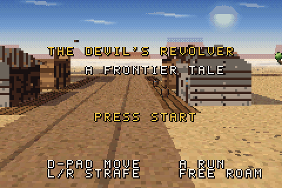
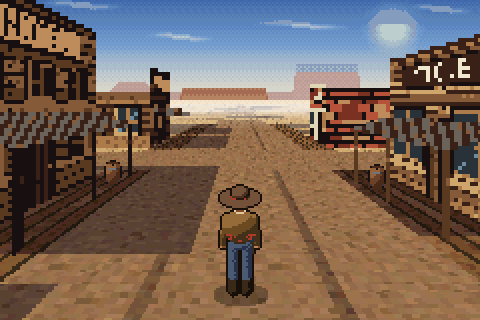
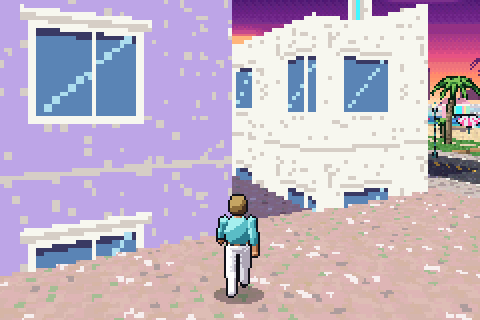
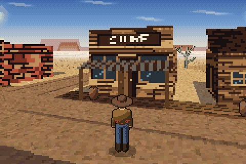

# The Devil's Revolver

A Game Boy Advance western. Wander the dusty main street of a frontier town and the desert around
it. The current build is **free roam**: no outlaws and no shooting yet (set `FREE_ROAM` to `0` in
`src/game.h` to bring back the bounty-hunting prototype).

 
 

Written from scratch in C and ARM assembly for the GBA — no libgba/libtonc, no external art. Every
texture, sprite and map is generated by the Python tools in `tools/` and checked in as C source.

## Controls

| Button | Action |
| --- | --- |
| D-pad up / down | walk forward / back |
| D-pad left / right | turn |
| A (hold) | run |
| L / R | strafe |
| Start | start game · toggle CPU meter |

## How it works

The engine is built in the spirit of *Driver 3* and *Asterix & Obelix XXL* on the GBA: let the
hardware do everything it can, and spend the CPU only where it is needed.

| Layer | Technique |
| --- | --- |
| Ground | **Mode 7** on affine BG2 (Mode 1). A per-scanline affine table is rebuilt each frame and streamed into the BG2 registers by **HBlank DMA**. 1024×1024 texel desert with main street, wheel ruts, boardwalks, building shadows, dry creek and railway. |
| Distance haze | A second HBlank DMA writes `BLDY` every line, fading the far ground into the horizon colour. |
| Sky | Regular BG0 panorama (sun, clouds, two layers of mesas) scrolled with the camera yaw; Window 0 splits sky and ground. |
| Buildings | Simple textured **3D meshes** (saloon, hotel, bank, sheriff, store, barber, houses, church with steeple, depot, water tower). A software renderer in **IWRAM / ARM** draws each into a small canvas — vertical walls column by column with exact perspective, roofs/gables with an affine triangle filler — then packs it into 4bpp OBJ tiles sized to fit (16×16 up to grids of 64×64). **Every visible building is re-rendered from its mesh every frame**, so perspective is always correct; far away, porches are dropped as a level of detail. |
| Characters | **8-direction** sprites (cowboy 64×64, outlaws 32×64), with idle, 6-frame walk and shooting poses, picked from the facing relative to the camera. |
| Scenery | Saguaros, Joshua trees, dead trees, bushes, rocks, barrels, skulls and tumbleweeds are **single-angle billboards** scaled by the OBJ affine hardware (31 shared scale matrices). |
| Draw order | All sprites are depth-sorted with a bucket sort into OAM each frame. |

Hot code (building renderer, Mode 7 table, billboard projection, collision) runs from IWRAM as
ARM code; the column filler and integer division are hand-written ARM assembly (`src/fill.s`,
`src/div.s`). Divisions in inner loops are replaced by reciprocal tables; wall texture
coordinates are perspective-correct every 8 columns and interpolated in between. The game runs
at a locked **30 fps** (game logic still steps at 60 Hz), the same target as Driver 3 on the GBA.

## Building

The ROM builds with **clang + lld** (no devkitPro needed):

```sh
sudo apt-get install clang lld llvm python3   # Ubuntu / Debian
make                                           # -> devils_revolver.gba
```

`make assets` regenerates `src/assets/*.c` from the Python generators (needs `numpy` and
`Pillow`). The generated sources are committed, so a normal build doesn't need Python packages
— only `python3` for the small header-checksum script.

Every push builds the ROM on GitHub Actions; download `devils_revolver.gba` from the run's
artifacts. The CI build also runs devkitPro's `gbafix` so the header is valid for real hardware
and flash carts.

Play it in any GBA emulator (mGBA, Pizza Boy, My Boy!, RetroArch) or on hardware with a flash cart.

## Layout

```
src/
  main.c        display setup, main loop, vblank presentation, OAM sort
  render.c      IWRAM ARM: building renderer, Mode 7 table, vblank DMA re-arm
  fill.s        ARM asm: unrolled column filler, tile packer, canvas clear
  div.s         ARM asm: EABI integer division
  world.c       IWRAM ARM: billboards, building sprites, collision
  actors.c      player, outlaws, tumbleweeds, chase camera, shooting
  hud.c         BG1 text HUD
  crt0.s gba.ld startup code, ROM header, IRQ handler, linker script
  assets/       generated graphics, meshes, map, tables
tools/
  gen_assets.py generate everything (gen_ground / gen_town / gen_sprites)
  fixheader.py  header checksum
```
