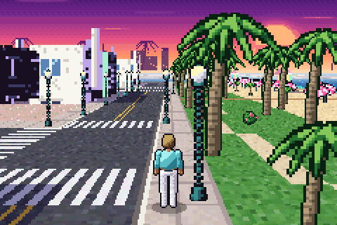
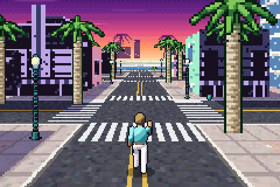
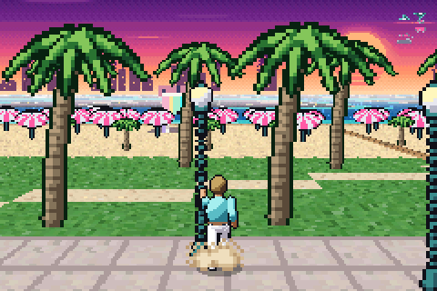

# The Devil's Revolver

An open-world game for **Android** and the **Game Boy Advance**, from one C codebase, set in
**Miami Beach, 1986**. Walk an island of pastel art-deco hotels with neon signs, avenues lined
with royal palms and street lamps, pavements and crosswalks, the palm park along Ocean Drive,
the beach with its umbrellas and lifeguard huts, and the ocean, all under an 80s sunset. The
current build is **free roam** (set `FREE_ROAM` to `0` in `src/game.h` for the old shooting
prototype).

 
 

Written from scratch in C and ARM assembly for the GBA — no libgba/libtonc, no external art. Every
texture, sprite and map is generated by the Python tools in `tools/` and checked in as C source.

**Download:** the newest Android APK and GBA ROM are on the
[Latest build release](https://github.com/HarlequinXD/The-Devil-s-Revolver/releases/tag/latest-build).

## Controls

| Button | Action |
| --- | --- |
| D-pad | walk in that direction (relative to the camera) |
| A (hold) | run |
| L / R | rotate the camera |
| Start | start game · toggle CPU meter |

The chase camera swings round behind you as you move away or across the view, like *Driver 3*
on the GBA. Walk toward the camera and it just backs up instead of turning, so you go in a straight
line. The D-pad direction is locked to the camera angle at the moment you press it, so holding
a direction never curves you round in a circle.

Sprites scale like *Doom*'s: every frame each one is drawn at exactly its projected size
(1 / distance), not snapped to preset steps. The GBA has 32 hardware scaling matrices; they're
handed out per frame to the exact scales in view, nearest sprites first.

## The map

A 1024×1024 island laid out on a street grid: West Avenue along the bay, Washington Avenue,
Collins Avenue and Ocean Drive running north–south, four cross streets, and blocks of deco
hotels between them (Palms, Coral, Seabreeze, Tropics, Neptune, Dunes, Surf, Cafe, Regal, Aqua)
plus two condo towers. East of Ocean Drive are the palm park, wooden boardwalks, the beach and
the surf. Seawalls and water close it in on every side, so you can't walk off the edge.

## Android

The Android app is a **native port, not an emulator**: the same C game code is compiled with
the NDK. On the GBA the picture is assembled by the hardware from background layers and
sprites; on Android `src/native/ppu.c` draws those same layers (sky, HUD, Mode 7 ground,
scaled sprites, haze and shadows) into a bitmap. The app runs at a fixed 60 ticks per second
and draws a handheld-style body with GBA-like controls: cross D-pad, A/B, L/R shoulder
buttons and Start/Select pills, with haptic feedback. Bluetooth/USB gamepads and keyboards
work too.

Build it with `gradle -p android assembleRelease` (Android SDK + NDK, CMake 3.22.1).

## How it works

The engine is built in the spirit of *Driver 3* and *Asterix & Obelix XXL* on the GBA: let the
hardware do everything it can, and spend the CPU only where it is needed.

| Layer | Technique |
| --- | --- |
| Ground | **Mode 7** on affine BG2 (Mode 1). A per-scanline affine table is rebuilt each frame and streamed into the BG2 registers by **HBlank DMA**. 1024×1024 texel island: asphalt with double yellow lines, zebra crosswalks, pavements with curbs, grass, sand, surf and sea, plus baked building shadows. |
| Distance haze | A second HBlank DMA writes `BLDY` every line, fading the far ground into the horizon colour. |
| Sky | Regular BG0 panorama (a striped sunset sun, cloud streaks, the downtown skyline and palm silhouettes) scrolled with the camera yaw; Window 0 splits sky and ground. |
| Buildings | Simple textured **3D meshes**: art-deco hotels with stepped parapets, neon cornices, eyebrow ledges and neon fins, condo towers and lifeguard huts on stilts. A software renderer in **IWRAM / ARM** draws each into a small canvas — vertical walls column by column with exact perspective, roofs/gables with an affine triangle filler — then packs it into 4bpp OBJ tiles sized to fit (16×16 up to grids of 64×64). **Every visible building is re-rendered from its mesh every frame**, so perspective is always correct. Buildings are drawn nearest first into a per-column **occlusion buffer**: one entirely behind nearer walls is skipped, and hidden parts of walls aren't filled. |
| Characters | **8-direction** sprites: the player (64×64) in a pastel blazer, white tee and trousers and shades, with breathing idle, 6-frame walk and 6-frame run, picked from the facing relative to the camera. |
| Scenery | Coconut, royal and fan palms, hibiscus, deco street lamps, beach umbrellas, bins, hydrants and wheeling seagulls are **single-angle billboards** scaled by the OBJ affine hardware. |
| Draw order | All sprites are depth-sorted with a bucket sort into OAM each frame. |

Hot code (building renderer, Mode 7 table, billboard projection, collision) runs from IWRAM as
ARM code; the column filler and integer division are hand-written ARM assembly (`src/fill.s`,
`src/div.s`). Divisions in inner loops are replaced by reciprocal tables; wall texture
coordinates are perspective-correct every 8 columns and interpolated in between. The game runs
at **30 fps** on the GBA, dipping to 20 at the busiest street corners (game logic still steps at 60 Hz), the same target as Driver 3
on the GBA, and at 60 fps on Android.

## Building

The ROM builds with **clang + lld** (no devkitPro needed):

```sh
sudo apt-get install clang lld llvm python3   # Ubuntu / Debian
make                                           # -> devils_revolver.gba
```

`make assets` regenerates `src/assets/*.c` from the Python generators (needs `numpy` and
`Pillow`). The generated sources are committed, so a normal build doesn't need Python packages
— only `python3` for the small header-checksum script.

Every push builds the ROM on GitHub Actions; download `devils_revolver.gba` from the run's
artifacts. The CI build also runs devkitPro's `gbafix` so the header is valid for real hardware
and flash carts.

Play it in any GBA emulator (mGBA, Pizza Boy, My Boy!, RetroArch) or on hardware with a flash cart.

## Layout

```
src/
  main.c        display setup, main loop, vblank presentation, OAM sort
  render.c      IWRAM ARM: building renderer, Mode 7 table, vblank DMA re-arm
  fill.s        ARM asm: unrolled column filler, tile packer, canvas clear
  div.s         ARM asm: EABI integer division
  world.c       IWRAM ARM: billboards, building sprites, collision
  actors.c      player, outlaws, seagulls, chase camera, shooting
  hud.c         BG1 text HUD
  crt0.s gba.ld startup code, ROM header, IRQ handler, linker script
  assets/       generated graphics, meshes, map, tables
  native/       Android/desktop: ppu.c layer renderer, host_test.c
android/        Kotlin app, JNI bridge, CMake build of the shared C code
tools/
  gen_assets.py generate everything (gen_ground / gen_town / gen_sprites)
  fixheader.py  header checksum
```
